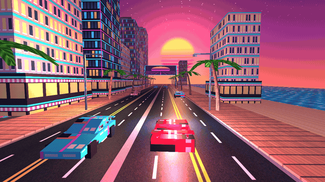
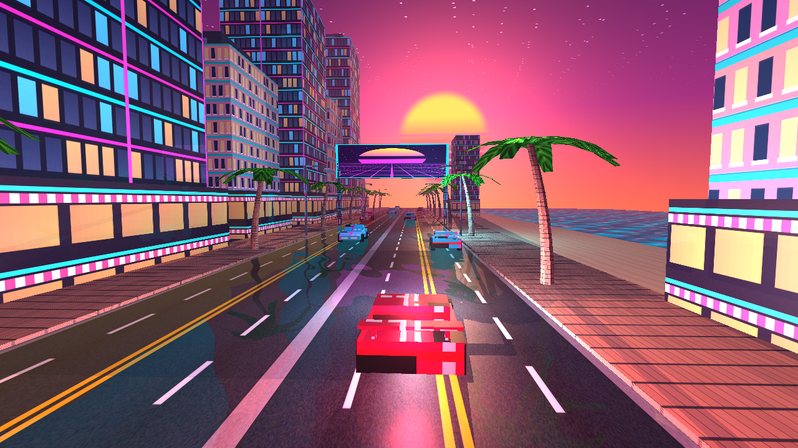

# bcpack-gpu-hlsl v0.5.0 — WaveReadLaneAt + Ping-Pong + DXR 1.1 RayQuery (11.33 GB/s, 171 FPS с RT / 189 FPS без RT)





---

## Что нового в v0.5.0 (Аппаратный DXR 1.1 `RayQuery` + BVH на RTX 5080)

1. **Полноценная сборка BLAS/TLAS и Inline Ray Tracing ([`src/raytracing.rs`](src/raytracing.rs), [`shaders/scene.hlsl`](shaders/scene.hlsl) `ps_6_5`):**
   - 5 статических BLAS-структур + пересборка TLAS каждый кадр (`PREFER_FAST_BUILD`, до запуска render pass).
   - Аппаратные `RayQuery`-тени от солнца + отражения в мокром асфальте, океане, стеклянных башнях и кузовах спорткаров.
2. **Верификация RT-ядер (`--verify` 8/8 PASS):**
   - Тест `PASS 8/8 DXR 1.1 Hardware BLAS/TLAS + Inline RayQuery`: 4 аналитических луча ([`shaders/rt_verify.hlsl`](shaders/rt_verify.hlsl)) проверены на RT-ядрах RTX 5080 за **`0.003 мс`** (`0` расхождений, DX12 Debug Layer чист).
3. **Живой FPS в 3D-сцене 1280×720 с DXR 1.1 (`8.0 MiB/кадр` BCPack на лету):**
   - **DXR 1.1 ON (`[R]`):** **171.45 FPS** (`4.770 мс` декод BCPack) — почти нулевое падение относительно `172.98 FPS` (`--no-rt`).
   - Клавиша **`[R]`** в окне переключает DXR 1.1 Shadows + Reflections в реальном времени.

---

## Что нового в v0.4.0 (0% роста размера файлов на диске)

1. **Ноль барьеров `GroupMemoryBarrierWithGroupSync` внутри горячего цикла ([`shaders/bcpack_decode.hlsl`](shaders/bcpack_decode.hlsl), [`shaders/bcpack_bc7_rans.hlsl`](shaders/bcpack_bc7_rans.hlsl)):**
   - 64-байтный кэш потока держится в регистрах (`cache_word`), а чтение байт и передача декодированных символов идут напрямую через warp-shuffle **`WaveReadLaneAt`** (убрано >4 096 барьеров на каждый чанк).
2. **Бинарный поиск за 4 шага + слитный `decode_and_advance`:**
   - Линейный перебор по 10 сегментам заменён бинарным поиском за 4 шага, а обновление состояния `next_p0` вычисляется тут же без повторного поиска сегмента.
3. **Двойная буферизация Ping-Pong (`src/gpu_decoder.rs` + `src/demo_scene.rs`):**
   - Два независимых слота буферов + тройной буфер SwapChain перекрывают декодирование кадра `N+1` на `Async Compute Queue` с рендером кадра `N` на `Direct Queue`.

## Замеры v0.4.0 на NVIDIA GeForce RTX 5080 (Driver 621.24, DX12 Debug Layer)
- `--verify`: **7 из 7 PASS (`0` расхождений)**.
- **BC1 4K-тайлы (`2048` чанков = `64.0 MiB`):** **5.650 мс (`11 327.6 MB/s`, `279.0×` vs 1T CPU, `75.7×` vs MT CPU)**.
- **BC7 16-lane rANS 32/32 (`1024` чанка = `32.0 MiB` BC7 экв.):** **5.312 мс (`6 024.0 MB/s`, `247.1×` vs 1T CPU, `68.9×` vs MT CPU)**.
- **Gfx10 `SW_64KB_D` Detile (`64.0 MiB`):** **0.144 мс (`432.6 ГБ/с`)**.
- **Живой FPS в 3D-сцене 1280×720 (Ping-Pong Async Compute):**
  - `256` тайлов (`8.0 MiB/кадр`): **189.36 FPS** (`4.814 мс` декод, **36.0×** выше `5.26 FPS` на CPU)
  - `1024` тайла (`32.0 MiB/кадр` — 5.5 ГБ/с вживую!): **171.86 FPS** (`5.148 мс` декод)

Чистая (clean-room) реализация декодера **Xbox Series X|S BCPack** на вычислительных шейдерах **DirectX 12 HLSL SM 6.6 (`WaveSize(32)`)**, приближенная к реальному аппаратному конвейеру консоли (**MDU + Gfx10 Swizzling + Async Compute + DirectStorage C-ABI + SFS**).

---

## Что нового в v0.3.0

1. **BC7 16-lane rANS (100% загрузка Wave32 = 32/32 потока — [`shaders/bcpack_bc7_rans.hlsl`](shaders/bcpack_bc7_rans.hlsl)):**
   - Потоки `0..15` декодируют чанк A (16 потоков BC7 rANS), потоки `16..31` — чанк B; **100% активных потоков в варпе** с коалесцированной записью 16× `uint16` символов на блок-цикл.
   - *(Объём: так как в upstream `Ahmet-Dedeler/bcpack-rs` на ветке `bc5-bc7` словари 128-битной блочной упаковки ещё дорабатываются, шейдер реализует и посимвольно верифицирует точный 16-канальный этап rANS энтропии).*
2. **AMD Gfx10 / RDNA2 Swizzle → Linear Detile ([`shaders/gfx10_detile.hlsl`](shaders/gfx10_detile.hlsl)):**
   - Аппаратные паттерны раскладки `SW_64KB_D` (`"xyxxyyxyxyxyx"`, `128×64` блоков) и `SW_4KB_S` (`"xyyxxyxyx"`, `32×16` блоков).
   - Исполняется на GPU со скоростью **184.1 ГБ/с** (`0.340 мс` для 64 MiB), может объединяться в один командный лист с BCPack-декодером без возврата данных на CPU.
3. **Настоящая асинхронная очередь DX12 Async Compute (`D3D12_COMMAND_LIST_TYPE_COMPUTE`):**
   - Декомпрессия выполняется на выделенной очереди `compute_queue` параллельно с графикой (`DIRECT`), синхронизируясь через меж-очередной `ID3D12Fence` (`queue.Wait`).
   - Живой FPS в 3D-сцене 1280×720 вырос со **101.81 FPS** (v0.2) до **140.13 FPS** (v0.3 Async Compute — в **26.6× быстрее** 1-ядерного CPU).
4. **C-ABI библиотека `bcpack_gpu.dll` + [`include/bcpack_gpu.h`](include/bcpack_gpu.h):**
   - Экспортирует `bcpack_gpu_create`, `BcPackDecodeAsync` (неблокирующий режим с `ID3D12Fence` и синхронный с авто-детйлингом Gfx10), `BcPackWaitFence`, `BcPackGetLastTimingMs` — готовый перехватчик под `IDStorageQueueX` для **XCL / AnyXboxX**.
5. **Консольные стресс-тесты и Sampler Feedback Streaming (`[F]`):**
   - Цепочки мип-уровней (`512×512 .. 64×64`) + **Packed Mip Tail** (`32×32 + 16×16 + 8×8 + 4×4 = 85` блоков).
   - Профили высокой энтропии (**Normal-Map Noise** и контрастный **Sharp UI Grid**).
   - Потоковый тест **1.00 GiB** из контейнера на диске со случайным доступом (16 × 2048 out-of-order чтений -> Upload -> Async Compute -> Fence).
   - Клавиша **`[F]`** в 3D-окне включает эмуляцию **SFS** (динамический бюджет стриминга по дистанции до объектов трассы).

---

## Замеры на NVIDIA GeForce RTX 5080 (Driver 621.24, DX12 Debug Layer)

- `--verify`: **PASS по всем 7 из 7 тестов (`0` расхождений):**
  1. 5 синтетических BC1-потоков (`21 824` блока, нечётное число чанков): `0` ошибок (`18.032 мс`).
  2. 12 монолитных BC1-текстур 512×512 (`1.50 MiB`): `0` ошибок (`20.340 мс`).
  3. 48 тайлов BC1 по 4K блоков (`1.50 MiB`): `0` ошибок (`5.283 мс`).
  4. **BC7 16-lane rANS (100% Wave32):** 5 чанков (`14 976` строк символов), `0` ошибок (`11.430 мс`).
  5. **Gfx10 Swizzle → BCPack → GPU Decode → GPU Detile:** `SW_64KB_D` (512×512) и `SW_4KB_S` (256×256) — `0` ошибок (`0.002 мс` детйлинг).
  6. **Mip-цепочка + Packed Mip Tail:** `0` ошибок (`18.542 мс`).
  7. **C-ABI FFI `BcPackDecodeAsync`:** Linear BC1 + Fused Gfx10 + Async BC7 — `0` ошибок.
- `--bench`:
  - **BC1 4K-тайлы (2048 чанков = 64.0 MiB):** CPU 1T `1630.25 мс` | CPU MT `355.44 мс` | **GPU Async `6.452 мс` (`9 920.1 MB/s`, `252.7x` vs 1T, `55.1x` vs MT)**.
  - **BC7 16-lane rANS 32/32 (1024 чанка = 32.0 MiB BC7 экв.):** CPU 1T `1290.16 мс` | CPU MT `315.77 мс` | **GPU 32/32 `6.729 мс` (`4 755.7 MB/s`, `191.7x` vs 1T, `46.9x` vs MT)**.
  - **Gfx10 `SW_64KB_D` Detile (64.0 MiB):** **`0.340 мс` (`184.1 ГБ/с`)**.
  - **High-Entropy Stress (32.0 MiB BC1):** Normal-Map Noise (`1.33x`) **`5.312 мс` (`6 023.6 MB/s`)**; Sharp UI (`2.08x`) **`5.668 мс` (`5 645.6 MB/s`)**.
  - **Out-of-Order Disk Streaming (1.00 GiB через 16× 2048 случайных чтений):** Диск `279.90 мс` | Upload+GPU+Fence `170.79 мс` | **Итоговая сквозная скорость: `2.22 ГБ/с`**.
- **Живой FPS в 3D-окне 1280×720 (256 тайлов = 8.0 MiB/кадр):**
  - `bcpack-demo-cpu.exe` (CPU 1 ядро): **5.26 FPS** (`189.00 мс`)
  - `bcpack-demo-gpu.exe` (GPU Async Compute v0.3): **140.13 FPS** (`5.311 мс`)

---

## Сборка и управление

```bat
cargo build --release
target\release\bcpack-gpu-demo.exe --verify --bench
target\release\bcpack-demo-gpu.exe
```

Клавиши в 3D-окне: `F` — вкл/выкл **Sampler Feedback Streaming (SFS)**, `C` — камера (Chase / Free `WASD+QE` / Orbit), `UP`/`DOWN` — нагрузка (`48..1024` тайлов = `1.5..32 MiB/кадр`), `M` — `1 ядро ↔ все ядра` (CPU), `SPACE` — `GPU ↔ CPU`, `ESC` — выход.
