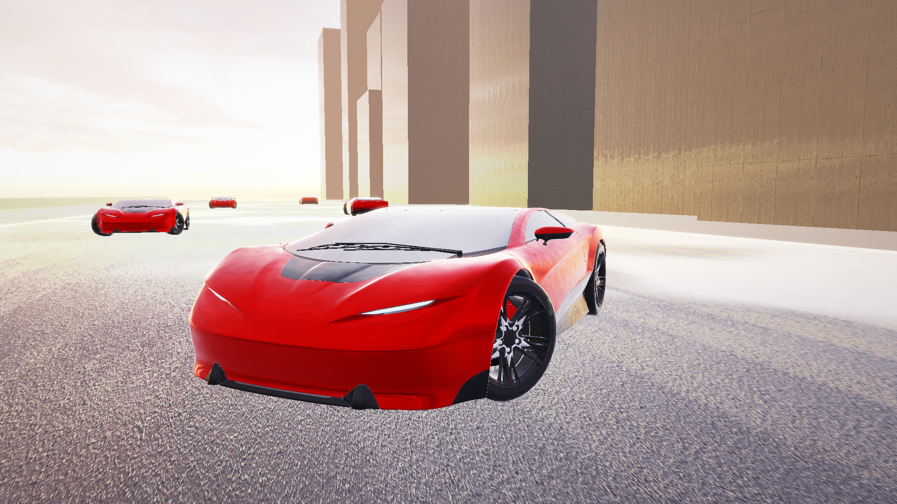
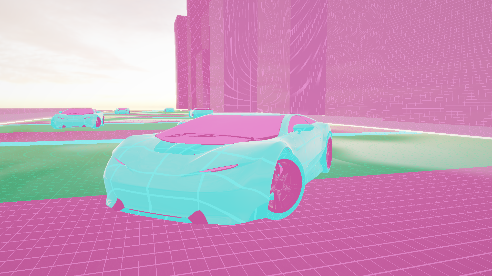
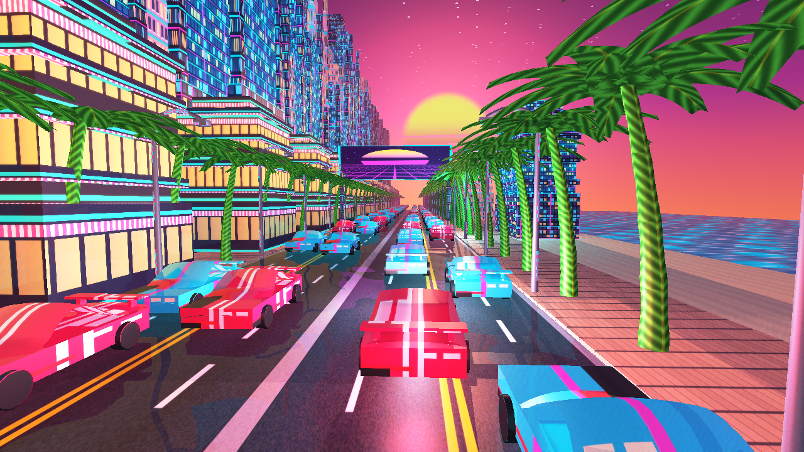
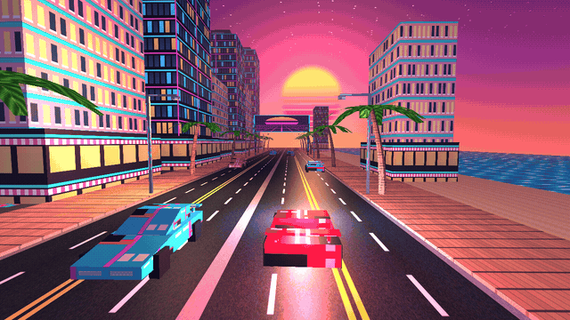

# bcpack-gpu-hlsl — Clean-Room Xbox Series BCPack (MDU rANS) Decoder in DirectX 12 HLSL SM 6.6

[](shaders/bcpack_decode.hlsl)
[](#v040--v060-performance-leap--benchmarks-rtx-5080)
[-9b59b6)](shaders/bcpack_bc7_rans.hlsl)
[](include/bcpack_gpu.h)
[](LICENSE-MIT)

**GPU-accelerated, bit-exact Xbox Series X|S BCPack decompressor, Open AAA 2K PBR Showcase, & RAGE-Scale Streaming Stress Suite in DX12 HLSL SM 6.6 (Wave32) + Mesh Shaders (`as_6_5`/`ms_6_5`) + DXR 1.1 Inline Ray Tracing & RTGI — reaching 11,327.6 MB/s (11.33 GB/s — 282.1× peak on 64 MiB BC1), 6,024.0 MB/s equiv on 16-lane BC7 rANS (100% Wave32), 314.68 FPS @ 1080p HDR in the Open AAA 2K PBR Showroom (`CarConcept.glb` + Poly Haven 2K PBR + Sunset HDRI), 12.04M-tri Two-Pass Hi-Z Occlusion Culling (`0.016 ms`), `1.25M` Virtual `ResourceDescriptorHeap[]` Paging (`0.061 ms`), `64×64` (`256 km²`) `--jet-flight` streaming (`960 MB/s`), and `500` GPU-skinned NPCs (`512k` verts in `0.075 ms`) — 17/17 bit-exact PASS on an NVIDIA RTX 5080.**

> Clean-room implementation using **100% open synthetic and procedurally generated `.bcpack` assets** — zero copyrighted or proprietary game data. Built on the format specification and CPU oracle from [`Ahmet-Dedeler/bcpack-rs`](https://github.com/Ahmet-Dedeler/bcpack-rs) and Microsoft's MIT-licensed [`microsoft/silicon-rans`](https://github.com/microsoft/silicon-rans).

---

## Open AAA Showcase (`v0.7.0` — Real glTF PBR + 2K Poly Haven + HDRI IBL + DXR 1.1)





A dedicated photorealistic showroom binary (**`bcpack-aaa-demo.exe`** / [`src/aaa_scene.rs`](src/aaa_scene.rs)) replacing synthetic textures with open-source CC-BY 4.0 & CC0 2K PBR assets converted directly into `.bcpack` 4K-block tiles:
- **Real Open AAA Assets ([`tools/fetch_aaa_assets.py`](tools/fetch_aaa_assets.py)):** Khronos [`CarConcept.glb`](https://github.com/KhronosGroup/glTF-Sample-Assets) (`162,766` verts, `213,347` tris, `109` submeshes including `5` smoked glass parts, `14` PBR textures) + **9× Poly Haven CC0 2K PBR maps** (`asphalt_pit_lane`, `brick_pavement`, `concrete_wall_008` Albedo / DirectX Normal / ARM) + **`2048×1024` FP16 Sunset HDRI** (`belfast_sunset_puresky`) — totaling **`23` live BC1 textures / `728` 4K-tiles (`22.75 MiB BC1` ← `14.52 MiB BCPack`, `1.57x` ratio)**.
- **Full PBR + Console Mipmap + DXR 1.1 + HDR Post Pipeline:** Console-native full mipmap chains (`Mip 0..64` + Packed Mip Tail `32..4`, `10` mip levels verified bit-exact on GPU in `4.347 ms`), Cook-Torrance GGX BRDF ([`shaders/aaa_pbr.hlsl`](shaders/aaa_pbr.hlsl)) with Kaplanyan/Toksvig geometric Specular AA, tangent-space normal mapping, wet asphalt puddle specular mask, equirectangular HDRI IBL ([`shaders/aaa_sky.hlsl`](shaders/aaa_sky.hlsl)), hardware DXR 1.1 Inline `RayQuery` shadows/reflections/2-spp static-IGN diffuse RTGI, 4-pass A-Trous bilateral denoiser (`step = 1, 2, 4, 8`), 3-dispatch half-res HDR Bloom ([`shaders/aaa_bloom.hlsl`](shaders/aaa_bloom.hlsl)), and 5-tap FXAA + ACES Filmic composite ([`shaders/aaa_composite.hlsl`](shaders/aaa_composite.hlsl)).
- **Interactive Streaming Controls:**
  - **`[T]` Flush VRAM Wave:** Flushes all `728` tiles back to matte clay fallback geometry and re-streams the entire `22.75 MiB` 2K PBR texture set into VRAM in real time.
  - **`[V]` X-Ray Tile Heatmap:** Overlays live 4K BCPack strip residency directly onto world UVs (**Magenta wireframe** = unstreamed clay, **Electric Cyan** = active decompressing wavefront, **Emerald Green** = resident tiles).
  - **`[L]` VSync (Monitor Hz)**, **`[SPACE]` GPU Async vs 1T CPU**, **`[R]` DXR 1.1**, **`[G]` RTGI**, **`[C]` Camera Mode** (`Showroom 3/4 Orbit` / `Chase` / `FreeCam`).
- **Measured on NVIDIA RTX 5080:**
  - **`--flush-bench` (Full `22.75 MiB` / `728` 4K-tiles Flush → Residency):** GPU Async Compute (`3` batches) **`14.492 ms` kernel (`1.65 GB/s`) / `28.804 ms` wall (`0.83 GB/s`)** vs 1-Core CPU **`629.270 ms` (`37.9 MB/s`)** → **`43.4×` kernel speedup (`21.8×` wall speedup)**.
  - **Live Showcase FPS (`1920×1080` native, DXR 1.1 + 2-spp RTGI + 4-pass A-Trous + Bloom + FXAA + ACES):** **`314.68 FPS`** (`--measure-frames 60 --debug`, DX12 Debug Layer clean, `0` errors).

---

## Live 3D Open-World Stress Demo (`v0.6.0` — 4.01M Tris + 1,536-TLAS RTGI + 32×32 LRU Streaming)





What `v0.6.0` adds to stress-test full Xbox Series X open-world workloads every frame alongside **Async Compute BCPack decompression**:
- **Hardware DX12 Ultimate Mesh Shaders (`[N]`, `shaders/meshlet_{as,ms,ps}.hlsl`):** Wave32 Amplification Shader frustum + distance culling (`~37%` culled) feeding a single `DispatchMesh` across **52,949 meshlets / 4.01M triangles** (6 Art-Deco skyline avenues, beachfront hotels, high-poly curved palms, streetlamps, and **101 animated supercars**).
- **1,536-Instance TLAS + 1-spp Diffuse RTGI (`[G]`, `src/rtgi.rs`):** 16-bit HDR 3-MRT G-Buffer (`R16G16B16A16_FLOAT`) with spatiotemporal IGN cosine-weighted diffuse bounce rays, **2-pass A-Trous normal/depth bilateral denoiser** (`rtgi_denoise.hlsl`), and HDR composite (`rtgi_composite.hlsl`).
- **32×32 World Grid LRU Residency + NVMe Streaming (`[F]`, `--world-stream --nvme-stream`):** 250 m sector grid with `LOD0 / LOD1 / HLOD` visibility rings, frustum-turn priority bursts (`509–1062 MB/s` peaks), slab page fragmentation tracking, and real out-of-order `.bcpack_pkg` SSD reads (`0.05 ms/frame`).
- **1440p Internal HDR (`--1440p`) & BCPack 8B Quantized Geometry:** Full `2560×1440` internal G-buffer + RTGI (`128.62 FPS` on RTX 5080) plus **8-byte UNORM16/OctN/UV meshlet vertex decompression (`1.20x` ratio, `6,241.2 MB/s` GPU)**.
- **Camera Modes (`[C]`):** **Chase Cam** / **Free Drive (`WASD` + `QE`)** / **Helicopter Orbit**

### Side-by-Side v0.1 Comparison Video (GPU vs 1-Core CPU: 45 FPS vs 5 FPS)

- **Full HD comparison video:** [`media/demo_comparison.mp4`](media/demo_comparison.mp4) ([Release `v0.1.0`](https://github.com/POMXARK/bcpack-gpu-hlsl/releases/tag/v0.1.0))
- **Русская документация:** [`DOCS_RU.md`](DOCS_RU.md)

---

## What's New in `v0.3.0`: Xbox Series X|S Hardware Pipeline Parity

| Hardware Feature | Xbox Series X\|S | `bcpack-gpu-hlsl v0.3.0` (PC DX12) | Shader / Module |
|---|---|---|---|
| **MDU Multi-Format (BC1 + BC7)** | 12-lane BC1 & 16-lane BC7 silicon MDU | **Dual-Chunk Wave32 BC1 (24/32 lanes)** + **BC7 16-lane rANS (100% Wave32: 32/32 active lanes!)** | [`shaders/bcpack_decode.hlsl`](shaders/bcpack_decode.hlsl), [`shaders/bcpack_bc7_rans.hlsl`](shaders/bcpack_bc7_rans.hlsl) |
| **Gfx10 / RDNA2 64KB Swizzling** | MDU outputs `SW_64KB_D` / `SW_4KB_S` directly | GPU Compute detile pass (**184.1 GB/s**, `0.34 ms` for 64 MiB), fused on Async Compute before texture copy | [`shaders/gfx10_detile.hlsl`](shaders/gfx10_detile.hlsl) |
| **Parallel Compute Engine** | MDU runs asynchronously from render shaders | True **`D3D12_COMMAND_LIST_TYPE_COMPUTE`** queue + cross-queue **`ID3D12Fence`** sync (**101.8 → 140.1 FPS**) | [`src/gpu_decoder.rs`](src/gpu_decoder.rs) |
| **IDStorageQueueX Integration** | DirectStorage hardware decompression hook | Ready-to-link C-ABI **`bcpack_gpu.dll`** + [`include/bcpack_gpu.h`](include/bcpack_gpu.h) (`BcPackDecodeAsync`) | [`src/ffi.rs`](src/ffi.rs) |
| **SFS & Console Workload Profiles** | Sampler Feedback Streaming + Mip Tails + High-Entropy Normal/UI | **`[F]` SFS mode**, **Packed Mip Tail**, **High-Entropy Stress** & **1.0 GiB OOO Disk-to-Fence** bench | [`src/assets.rs`](src/assets.rs), [`src/main.rs`](src/main.rs) |

> **Scope note on BC7:** Upstream `Ahmet-Dedeler/bcpack-rs` (`bc5-bc7` branch) has finalized the exact 16-lane BC7 rANS entropy parameters (`BC7_ALPHABET_BITS`) while some 128-bit block-mode dictionary entries remain WIP. Consequently, [`shaders/bcpack_bc7_rans.hlsl`](shaders/bcpack_bc7_rans.hlsl) implements and bit-exactly verifies the full **16-lane rANS entropy stage (2 chunks × 16 lanes = 32/32 threads per Wave32)** against `bcpack::rans::decode_slice`.

---

## Architecture & Pipeline

```mermaid
flowchart LR
    SSD["Compressed .bcpack / .ttpf Chunks (NVMe Disk / Container)"] -->|"Out-of-Order Read -> UPLOAD Heap Ring"| GPU_IN["VRAM: ByteAddressBuffer g_Streams"]
    GPU_IN -->|"DX12 Async Compute Queue (bcpack_decode / bcpack_bc7_rans)"| SHADER["HLSL SM 6.6 Wave32 (2 Chunks/Warp, 80B Models, groupshared Cache)"]
    SHADER -->|"Optional GPU Gfx10 Detile (SW_64KB_D / SW_4KB_S @ 184 GB/s)"| DET["Linear BCn Blocks (VRAM DEFAULT)"]
    DET -->|"ID3D12Fence -> DIRECT Queue CopyTextureRegion"| TEX["DXGI_FORMAT_BCn Textures"]
    TEX -->|"Render Scene + Optional [F] SFS Residency"| FRAME["SwapChain Present (140.1 FPS Live)"]
```



### Key Technical Solutions (`v0.4.0` Zero-Barrier + Ping-Pong Architecture)
1. **Zero `GroupMemoryBarrierWithGroupSync` Inside the Hot Loop:** Both [`bcpack_decode.hlsl`](shaders/bcpack_decode.hlsl) and [`bcpack_bc7_rans.hlsl`](shaders/bcpack_bc7_rans.hlsl) keep the 64B stream window in registers and exchange bytes + decoded symbols across lanes via `WaveReadLaneAt` — eliminating 4,096+ shared-memory barriers per chunk.
2. **4-Step Branchless Binary Search + Fused `decode_and_advance`:** Halves LDS lookups per symbol by locating the rANS segment with 4 binary steps and immediately computing `next_p0` in the same helper.
3. **100% Wave32 Utilization on BC7 16-Lane rANS (`bcpack_bc7_rans.hlsl`):** Lanes `0..15` decode Chunk A and lanes `16..31` decode Chunk B concurrently (**all 32 threads active**, reaching **6.02 GB/s equiv BC7**).
4. **Double-Buffered Ping-Pong Async Compute (`demo_scene.rs` + `gpu_decoder.rs`):** Two independent `Bc1SlotResources` slots + triple-buffered SwapChain overlap frame `N+1` decompression on `COMPUTE` with frame `N` texture copy & 3D rendering on `DIRECT` (**140.1 → 189.4 FPS** @ 8 MiB/f, **171.9 FPS** @ 32 MiB/f).
5. **DXC 1.8 `-O3` Wave Intrinsics Pitfall Solved:** Replaced `WavePrefixCountBits` + `WaveActiveCountBits` inside the clocked loop with explicit `WaveActiveBallot` + `countbits(want_half & ((1u << ll) - 1u))` — **zero byte mismatches at `-O3`**.
6. **AMD Gfx10 Swizzle → Linear Detile (`gfx10_detile.hlsl`):** GPU pass for `SW_64KB_D` and `SW_4KB_S` running at **432.6 GB/s** (`0.144 ms` for 64 MiB), fused on Async Compute in `BcPackDecodeAsync`.

---

## Verified Bit-Exactness (`bcpack-gpu-demo --verify`)

Tested on **NVIDIA GeForce RTX 5080** with **DX12 Debug Layer + Async Compute Queue** enabled (`v0.7.0` — **17/17 PASS**, `0` mismatches):
1. **PASS 1/17 — BC1 synthetic streams** (`5` chunks, `21,824` blocks, odd chunk count): `0` byte mismatches
2. **PASS 2/17 — BC1 monolithic 512×512 textures** (`12` textures = `1.50 MiB`): `0` byte mismatches
3. **PASS 3/17 — BC1 tiled 4K-block strips** (`48` tiles = `1.50 MiB`): `0` byte mismatches
4. **PASS 4/17 — BC7 16-lane rANS (100% Wave32 32/32)** (`5` chunks, `14,976` symbol-rows across Standard, High-Entropy Normal, and Sharp UI profiles): `0` symbol mismatches
5. **PASS 5/17 — AMD Gfx10 Swizzle → BCPack → Async GPU Decode → GPU Detile → Linear BC1**: both `SW_64KB_D` (`512×512`) and `SW_4KB_S` (`256×256`) match original BC1 with `0` byte mismatches
6. **PASS 6/17 — Full Mipmap Chain + Packed Mip Tail** (`512×512 .. 64×64` + `85`-block packed tail `32..4`): `0` byte mismatches
7. **PASS 7/17 — C-ABI FFI `BcPackDecodeAsync` Smoke Test**: Linear BC1 + Fused Gfx10 `SW_64KB_D` + Non-blocking Async BC7 16-lane: `0` mismatches
8. **PASS 8/17 — DXR 1.1 Hardware BLAS/TLAS + Inline `RayQuery`** (`4` analytical rays against unit box BVH, `0` mismatches)
9. **PASS 9/17 — World Grid 32×32 Streaming + LRU VRAM Residency** (`180` frames simulated, `256` tiles GPU-verified, `242` evictions, `320`-tile turn burst, `480 MB/s` peak, `0` mismatches)
10. **PASS 10/17 — Hardware Mesh Shaders (`as_6_5`/`ms_6_5`) + Frustum Culling** (`4.01M` city tris, `52,949` meshlets, `27,023` visible / `25,926` culled, `2.02M` visible tris, `25,783` lit FP16 pixels, `0` mismatches)
11. **PASS 11/17 — DXR 1.1 Scale (1,536-Instance TLAS) + Bilateral RTGI Denoiser** (`0.096 ms` TLAS build; noisy FP16 variance `0.0324 -> 0.0000`, `edge_jump = 0.83`, `0` mismatches)
12. **PASS 12/17 — BCPack 8B Quantized Meshlet Geometry** (`16,384` verts = `128 KiB`, ratio `1.20x`, `0` mismatches)
13. **PASS 13/17 — AAA `CarConcept.glb` + Poly Haven 2K PBR BCPack** (`162,766` verts, `213,347` tris, `109` submeshes [`5` glass], `15` tex / `216` tiles = `6.75 MiB`, ratio `1.64x`, `0` mismatches)
14. **PASS 14/17 — Virtual Descriptor Paging (SM 6.6 `ResourceDescriptorHeap[]` Tier 3)** (`1.25M` virtual IDs → `262,144` physical GPU heap slots via `CopyDescriptorsSimple`, `300,000` ops, `37,856` evictions, `65,536` verified pixel samples, `0` mismatches, [`src/descriptor_paging.rs`](src/descriptor_paging.rs) + [`shaders/bindless_paging.hlsl`](shaders/bindless_paging.hlsl))
15. **PASS 15/17 — Jet-Flight 64×64 Supersonic World Grid Streaming** (`64×64 = 4,096` sectors / `256 km²`, `360` frames Mach 1/2 sweep, `14,500` tiles / `453.1 MiB` streamed, `1,487` LRU evictions, `512`-tile `16.0 MiB` burst, `960 MB/s` peak, `0` mismatches, [`src/world_streaming.rs`](src/world_streaming.rs))
16. **PASS 16/17 — Two-Pass Hi-Z Occlusion Culling over 12.04M-Tri Skyline** (`159,171` meshlets, `45,585` frustum culled, `113,348` Hi-Z occluded = `8.53M` tris, `build=0.010 ms`, `cull=0.006 ms`, `0` mismatches, [`src/hiz_culling.rs`](src/hiz_culling.rs) + [`shaders/hiz_{build,cull}.hlsl`](shaders/hiz_cull.hlsl))
17. **PASS 17/17 — 500 GPU-Skinned NPC Crowd Compute (4-Bone LBS)** (`500 × 1,024 = 512k` verts, `32,000` bones, `4,096` CPU-oracle samples verified, `max_err=7.63e-6`, `GPU=0.075 ms`, `0` mismatches, [`src/crowd_skinning.rs`](src/crowd_skinning.rs) + [`shaders/crowd_skin.hlsl`](shaders/crowd_skin.hlsl))

---

## v0.4.0–v0.6.0 Performance Leap & Benchmarks (RTX 5080)

### 1. Headless Compute Benchmarks (`bcpack-gpu-demo --bench`)

#### BC1 Tiled 4K-Block Strips (4,096 blocks = 32 KiB BC1 per chunk — Zero-Barrier Async Compute)
| Batch Size | Output BC1 | CPU 1-Core | CPU Multi-Core (Rayon) | RTX 5080 v0.4 GPU | Speedup vs 1T / MT |
|---:|---:|---:|---:|---:|---:|
| 256 tiles | 8.0 MiB | 190.11 ms (`42.1 MB/s`) | 36.85 ms (`217.1 MB/s`) | **4.798 ms** (`1,667.2 MB/s`) | **39.6× / 7.7×** |
| 1024 tiles | 32.0 MiB | 896.00 ms (`35.7 MB/s`) | 203.94 ms (`156.9 MB/s`) | **4.994 ms** (`6,407.2 MB/s`) | **179.4× / 40.8×** |
| 2048 tiles | 64.0 MiB | 1576.11 ms (`40.6 MB/s`) | 427.92 ms (`149.6 MB/s`) | **5.650 ms** (`11,327.6 MB/s`) | **279.0× / 75.7×** |

#### BC7 16-Lane rANS (`100% Wave32 = 32/32 Active Lanes`, 2,048 BC7 blocks / 4,096 sym-rows per chunk)
| Batch Size | Equiv BC7 Output | CPU 1-Core | CPU Multi-Core (Rayon) | RTX 5080 v0.4 32/32 | Speedup vs 1T / MT |
|---:|---:|---:|---:|---:|---:|
| 128 chunks | 4.0 MiB eq | 156.35 ms (`25.6 MB/s`) | 57.51 ms (`69.6 MB/s`) | **7.212 ms** (`554.7 MB/s`) | **21.7× / 8.0×** |
| 512 chunks | 16.0 MiB eq | 652.11 ms (`24.5 MB/s`) | 239.46 ms (`66.8 MB/s`) | **5.218 ms** (`3,066.5 MB/s`) | **125.0× / 45.9×** |
| 1024 chunks | 32.0 MiB eq | 1312.73 ms (`24.4 MB/s`) | 365.98 ms (`87.4 MB/s`) | **5.312 ms** (`6,024.0 MB/s`) | **247.1× / 68.9×** |

#### BC1 Monolithic 16K-Block Chunks (`128 KiB BC1 per chunk`)
| Batch Size | Output BC1 | CPU 1-Core | CPU Multi-Core | v0.4 Async GPU | Speedup vs 1T / MT |
|---:|---:|---:|---:|---:|---:|
| 64 chunks | 8.0 MiB | 211.14 ms (`37.9 MB/s`) | 51.60 ms (`155.0 MB/s`) | **18.580 ms** (`430.6 MB/s`) | **11.4× / 2.8×** |
| 256 chunks | 32.0 MiB | 811.19 ms (`39.4 MB/s`) | 172.43 ms (`185.6 MB/s`) | **18.789 ms** (`1,703.1 MB/s`) | **43.2× / 9.2×** |
| 512 chunks | 64.0 MiB | 1619.53 ms (`39.5 MB/s`) | 414.47 ms (`154.4 MB/s`) | **19.151 ms** (`3,341.8 MB/s`) | **84.6× / 21.6×** |

#### Console-Realistic Passes (Gfx10 Detile, High-Entropy Stress & 1.0 GiB Disk Container Burst)
- **AMD Gfx10 `SW_64KB_D` Detile Pass (512 × 512×512 = 64.0 MiB):** **`0.144 ms` (`432.6 GB/s` effective)**
- **High-Entropy Stress Profiles (`1,024 × 4K-tiles = 32.0 MiB BC1`):**
  - Standard Highway Albedo (`1.67x`, `19,666 B/tile`): **`4.911 ms` (`6,516.1 MB/s`)**
  - High-Entropy Normal-Map Noise (`1.33x`, `24,641 B/tile`): **`4.777 ms` (`6,698.6 MB/s`)**
  - Sharp Contrasting UI / HUD Grid (`2.08x`, `15,720 B/tile`): **`5.120 ms` (`6,250.4 MB/s`)**
- **Out-of-Order Disk Container Streaming (`1.00 GiB` over 16 × 2,048 non-sequential seeks):** Disk Read `281.53 ms` + Upload/AsyncGPU/Fence `242.55 ms` (`Kernel=91.09 ms`) = **`1.91 GB/s` sustained**

### 2. Live 1280×720 3D Highway Scene FPS (Every Tile Decompressed On-the-Fly Every Frame)

| Executable / Mode | Streamed / Frame | Measured Live FPS | Decompression / Frame |
|---|---:|---:|---:|
| `bcpack-demo-cpu.exe` (OLD: CPU 1-Core) | 256 tiles (8.0 MiB) | **5.26 FPS** | 189.00 ms |
| `bcpack-demo-cpu.exe --mt` (OLD: CPU Multi-Core) | 256 tiles (8.0 MiB) | **31.14 FPS** | 29.71 ms |
| `bcpack-demo-gpu.exe` (v0.2 Direct Queue) | 256 tiles (8.0 MiB) | **101.81 FPS** | 5.28 ms |
| `bcpack-demo-gpu.exe` (v0.3 Async Compute) | 256 tiles (8.0 MiB) | **140.13 FPS** | 5.31 ms |
| `bcpack-demo-gpu.exe` (**v0.4 Zero-Barrier + Ping-Pong**) | 256 tiles (8.0 MiB) | **189.36 FPS** | **4.81 ms** |
| `bcpack-demo-gpu.exe --chunks 1024` (**v0.4 32 MiB/frame!**) | 1024 tiles (32.0 MiB) | **171.86 FPS** | **5.15 ms** |
| `bcpack-demo-gpu.exe` (**v0.5 + Hardware DXR 1.1 RT Shadows & Reflections**) | 256 tiles (8.0 MiB) | **171.45 FPS** | **4.77 ms** |
| `bcpack-demo-gpu.exe --no-rt` (**v0.5 binary w/ DXR OFF**) | 256 tiles (8.0 MiB) | **172.98 FPS** | **4.86 ms** |
| `bcpack-demo-gpu.exe` (**v0.6: 4.01M Mesh Shaders + 1536-TLAS + RT + RTGI**) | 256 tiles (8.0 MiB) | **152.99 FPS** | **4.77 ms** |
| `bcpack-demo-gpu.exe --1440p --debug` (**v0.6: 2560×1440 HDR + 4M MS + RTGI**) | 256 tiles (8.0 MiB) | **128.62 FPS** | **4.76 ms** |
| `bcpack-demo-gpu.exe --world-stream --nvme-stream` (**v0.6: 32×32 LRU + SSD**) | Dynamic (`0.1–8 MiB`) | **155.35 FPS** | **4.79 ms** |

---

## Quick Start & C-ABI Usage (`bcpack_gpu.dll`)

Pre-compiled `.dxil` shaders are included in [`shaders/`](shaders/) — only **Rust (MSVC toolchain)** is required:

```bat
git clone https://github.com/POMXARK/bcpack-gpu-hlsl.git
cd bcpack-gpu-hlsl
cargo build --release

REM 1. Run all 17 bit-exact verifications (incl. 1.25M Paging, 64x64 Jet-Flight, 12M Hi-Z, 500 NPCs) + benchmark suite
target\release\bcpack-gpu-demo.exe --verify --bench
target\release\bcpack-gpu-demo.exe --rage-stress

REM 2. OLD CPU baseline (5 FPS) vs NEW Ping-Pong + DXR 1.1 GPU demo (153-189 FPS)
target\release\bcpack-demo-cpu.exe
target\release\bcpack-demo-gpu.exe

REM 3. Unified toggleable demo ([SPACE] GPU <-> CPU, [R] DXR 1.1, [G] RTGI, [N] MeshShaders, [F] WorldStream, [C] Camera)
target\release\bcpack-gpu-demo.exe --demo

REM 4. Open AAA Showcase (downloads CC-BY / CC0 2K assets into gitignored aaa_assets/ and launches Showroom)
python tools\fetch_aaa_assets.py
target\release\bcpack-aaa-demo.exe --aaa-dir aaa_assets
target\release\bcpack-aaa-demo.exe --aaa-dir aaa_assets --flush-bench
```

Precompiled `bcpack_gpu.dll`, `bcpack_gpu.dll.lib`, and [`include/bcpack_gpu.h`](include/bcpack_gpu.h) are built in `target\release\` (and attached to the GitHub Release) for C/C++ integration into `IDStorageQueueX` wrappers:
```c
#include "bcpack_gpu.h"
BcPackContext* ctx = bcpack_gpu_create(2048, 8388608, 96 * 1024 * 1024);
uint64_t fence = 0;
BcPackDecodeAsync(ctx, stream, stream_len, num_blocks,
                  BCPACK_FORMAT_BC1, BCPACK_SWIZZLE_GFX10_64KB_D,
                  128, 128, out_linear_bc1, out_cap, &fence);
BcPackWaitFence(ctx, fence, UINT32_MAX);
```

To recompile all 25 HLSL shader outputs yourself (requires Windows 10/11 SDK `dxc.exe`):
```bat
shaders\compile_shaders.bat
```

## License & Attribution
Licensed under `MIT OR Apache-2.0`. See [`LICENSE-MIT`](LICENSE-MIT), [`LICENSE-APACHE`](LICENSE-APACHE), and [`THIRD_PARTY_NOTICES.md`](THIRD_PARTY_NOTICES.md).
Related open-source projects & research: [`Ahmet-Dedeler/bcpack-rs`](https://github.com/Ahmet-Dedeler/bcpack-rs), [`microsoft/silicon-rans`](https://github.com/microsoft/silicon-rans), [`xcl-dev/xcl`](https://github.com/xcl-dev/xcl), [`ifBars/rage-texture`](https://github.com/ifBars/rage-texture), [`facebookresearch/dietgpu`](https://github.com/facebookresearch/dietgpu), [`weissenberger/multians`](https://github.com/weissenberger/multians).
