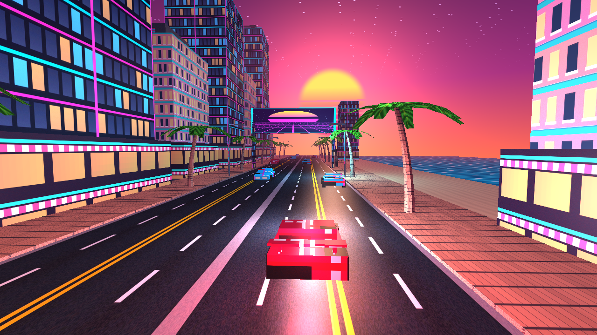
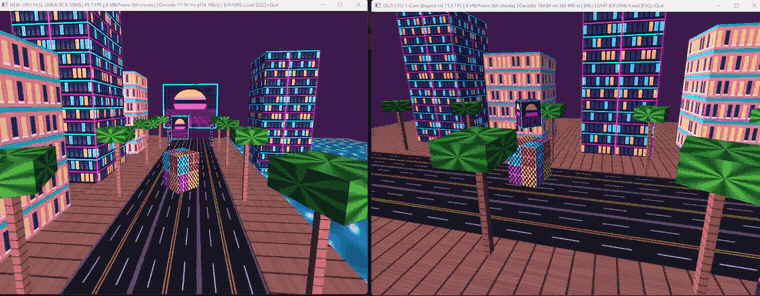

# bcpack-gpu-hlsl — Clean-Room Xbox Series BCPack (MDU rANS) Decoder in DirectX 12 HLSL SM 6.6

[](shaders/bcpack_decode.hlsl)
[](#v020-performance-leap--benchmarks-rtx-5080)
[](Cargo.toml)
[](LICENSE-MIT)
[](#verified-bit-exactness)

**GPU-accelerated, bit-exact Xbox Series X|S BCPack (BC1) decompressor written in HLSL Shader Model 6.6 Compute Shaders + DirectX 12 (Rust), reaching 9,877.1 MB/s (9.88 GB/s — 227.2× faster than 1-core CPU and 34.7× faster than multi-core CPU) on an NVIDIA RTX 5080 — with zero CPU decompression and zero uncompressed-texture PCIe copies.**

> Clean-room implementation using **100% open synthetic and procedurally generated `.bcpack` assets** — zero copyrighted or proprietary game data. Built on the exact format specification and CPU oracle from [`Ahmet-Dedeler/bcpack-rs`](https://github.com/Ahmet-Dedeler/bcpack-rs) and Microsoft's MIT-licensed [`microsoft/silicon-rans`](https://github.com/microsoft/silicon-rans).

---

## v0.2.0 Highlights: Coastal Highway 3D Game Scene + Dual-Chunk Wave32 (101.8 FPS Live)



In **v0.2.0**, every frame decompresses **256–1,024 compressed 4K-block `.bcpack` tiles (8–32 MiB of BC1 output per frame!)** on the fly directly into 12 live `512×512 DXGI_FORMAT_BC1_UNORM` textures driving an interactive Vice-City Coastal Highway 3D scene:
- **Cruising Hero Sports Car** + **10 animated traffic coupes** across a 4-lane wet asphalt highway
- **Curved 3D Palm Trees** with swaying fronds, **Streetlamps**, **Multi-tier Art-Deco skyline** with neon storefronts & rooftop penthouses, **Oceanfront Boardwalk**, **Beach**, and **Animated Ocean Waves**
- **Full-screen Sunset Synthwave Sky Shader** (`shaders/sky.hlsl`) + **Blinn-Phong Specular & 4 Dynamic Point Lights** (`shaders/scene.hlsl`)
- **Camera Modes (`[C]`):** Third-person **Chase Cam** / **Free Drive (`WASD` + `QE`)** / **Helicopter Orbit**

### Side-by-Side v0.1 Comparison Video (GPU vs 1-Core CPU)

- **Full 30s HD comparison video (cropped, no audio):** [`media/demo_comparison.mp4`](media/demo_comparison.mp4) ([Release `v0.1.0`](https://github.com/POMXARK/bcpack-gpu-hlsl/releases/tag/v0.1.0))
- **Русская документация:** [`DOCS_RU.md`](DOCS_RU.md)

---

## The Problem: Why Xbox Series Compatibility Layers Bottleneck at 0.3–5 FPS

Compatibility layers running Xbox Series X|S builds on Windows PC (such as **XCL**, **AnyXboxX**, and **VIctory**) hit severe open-world frame-rate collapses (`0.3–5 FPS`) when streaming dense world textures:

1. **No BCPack hardware block on PC GPUs:** Xbox Series X|S has a dedicated silicon **Media Decompression Unit (MDU)** that unpacks rANS-compressed `BC1–BC7` texture streams directly in memory. PC GPUs support **DirectStorage + GDeflate / Zstd**, not Microsoft's proprietary BCPack bitstream.
2. **CPU decompression chokes at ~43 MB/s per core:** Existing open-source BCPack decoders (`bcpack-rs`, `rage-texture`, `bcpack-decoder`) run on the CPU.
3. **PCIe bandwidth wasted on unpacked textures:** CPU decoding forces uploading larger unpacked `BCn` blocks over PCIe every frame instead of compact compressed chunks.
4. **Offline re-encoding 200+ GB archives is painful:** On-the-fly GPU compute decompression avoids touching files on disk.

---

## Key Solutions & v0.2.0 Optimizations

### 1. Dual-Chunk Wave32 Packing (`75%` Active Warp Utilization — `24/32` Lanes)
In v0.1, 1 Wave32 warp decoded 1 chunk (12/32 lanes active = `37.5%`). In **v0.2.0** ([`shaders/bcpack_decode.hlsl`](shaders/bcpack_decode.hlsl)):
- **Lanes `0..11`** decode **Chunk A**; **Lanes `16..27`** decode **Chunk B** simultaneously in the same Wave32 threadgroup (`Dispatch(num_chunks / 2, 1, 1)`).
- Each half-warp has independent `WaveActiveBallot` bitmasks via `(ballot >> half_shift) & 0xFFFu` (`half_shift = 0` or `16`).

### 2. Coalesced Stream Cache + Transposed `groupshared` Model Cache (80-Byte Models)
- `ModelDataGpu` is packed into **80 bytes** (`bf = base | (freq << 16)`, `rfrsn = rf | (rs << 16) | (rn << 21)` — verified `RS <= 16`, `RN <= 1`), eliminating the `thr[10]` array completely.
- At `HDR1` (once per fragment, e.g. 4,096 symbols), each lane caches its 10-segment model into bank-conflict-free transposed `groupshared` arrays (`lane_bf[10][24]`, `lane_rfrsn[10][24]`). Every symbol decode reads **zero global memory**.
- Each half-warp maintains a coalesced 64-byte `groupshared uint stream_cache[2][16]`, refilled by all 16 threads of that half in a single `g_Streams.Load`.
- Per-cycle `WaveActiveSum` deadlock checks are amortized to **once every 64 cycles**.

### 3. Branch-Free 8-Byte/Clock Feeder + DXC `-O3` Wave Intrinsics Pitfall Solved
- **Pitfall discovered on DXC 1.8 (`-T cs_6_6 -O3`) / NVIDIA driver 621.24:** Using `WavePrefixCountBits(want_byte)` followed by `WaveActiveCountBits(valid)` inside the clocked loop caused an `-O3` optimizer miscompilation (`stream_pos` stalled early while `-Od` passed).
- **Fix:** Replaced both with explicit `WaveActiveBallot` + `countbits(want_half & ((1u << ll) - 1u))`, which compiles cleanly at `-O3` and passes 100% bit-exact checks.

### 4. Low-Latency 4K-Block Tiled Streaming + On-the-Fly 200+ GB Architecture
Splitting 512×512 textures into 4,096-block strips (32 KiB BC1 per tile) cuts per-frame GPU decompression latency from **17.55 ms → 5.28 ms** while quadrupling warp concurrency across RTX 5080's 84 SMs:

```mermaid
flowchart LR
    SSD["200+ GB Archives on NVMe (Compressed BCPack Chunks/Tiles)"] -->|"Read only needed chunks (32-64 MiB UPLOAD ring)"| GPU_IN["VRAM: ByteAddressBuffer g_Streams"]
    GPU_IN -->|"DX12 Async Compute: 1 Wave32 = 2 Chunks (75% active)"| SHADER["HLSL SM 6.6: Dual 12-lane rANS + groupshared caches"]
    SHADER -->|"CopyTextureRegion (+ Gfx10 detile) via ID3D12Fence"| TEX["VRAM: DXGI_FORMAT_BCn Textures"]
    TEX -->|"Render 3D scene (zero CPU unpack, zero unpacked PCIe)"| FRAME["SwapChain Present (101+ FPS)"]
```



---

## Verified Bit-Exactness

Tested on **NVIDIA GeForce RTX 5080 (Driver 621.24)**, Windows SDK `10.0.26100.0` (`DXC 1.8`):
- `bcpack-rs` upstream suite (`cargo test --release`): **PASS** (3 unit + 10 roundtrip + 1 doctest).
- `bcpack-gpu-demo --verify`:
  - **5 synthetic streams** (21,824 blocks, odd chunk count testing dual-chunk padding): **PASS (`0` byte mismatches)**.
  - **12 monolithic 512×512 `.bcpack` textures** (1.50 MiB BC1): **PASS (`0` byte mismatches)**.
  - **48 tiled 4K-block `.bcpack` strips** (1.50 MiB BC1): **PASS (`0` byte mismatches)**.

---

## v0.2.0 Performance Leap & Benchmarks (RTX 5080)

### Console Throughput (`bcpack-gpu-demo --bench`)

#### Tiled 4K-Block Strips (4,096 blocks = 32 KiB BC1 per chunk — Low-Latency Streaming)
| Batch Size | Output BC1 | CPU 1-Core | CPU Multi-Core (Rayon) | RTX 5080 GPU Kernel | Speedup vs 1T / MT | GPU + PCIe Upload |
|---:|---:|---:|---:|---:|---:|---:|
| 256 tiles | 8.0 MiB | 187.96 ms (`42.6 MB/s`) | 31.10 ms (`257.3 MB/s`) | **5.321 ms** (`1,503.6 MB/s`) | **35.3× / 5.8×** | 6.35 ms (`1,260.6 MB/s`) |
| 1024 tiles | 32.0 MiB | 744.06 ms (`43.0 MB/s`) | 111.53 ms (`286.9 MB/s`) | **5.576 ms** (`5,739.3 MB/s`) | **133.5× / 20.0×** | 5.98 ms (`5,351.8 MB/s`) |
| 2048 tiles | 64.0 MiB | 1471.99 ms (`43.5 MB/s`) | 224.60 ms (`284.9 MB/s`) | **6.480 ms** (`9,877.1 MB/s`) | **227.2× / 34.7×** | 7.34 ms (`8,721.3 MB/s`) |

#### Monolithic 16K-Block Chunks (16,384 blocks = 128 KiB BC1 per chunk)
| Batch Size | Output BC1 | CPU 1-Core | CPU Multi-Core | v0.1 GPU Kernel | v0.2 GPU Kernel | Speedup vs 1T / MT |
|---:|---:|---:|---:|---:|---:|---:|
| 64 chunks | 8.0 MiB | 191.79 ms | 31.20 ms | 17.550 ms (`455.8 MB/s`) | 20.465 ms (`390.9 MB/s`) | 9.4× / 1.5× |
| 256 chunks | 32.0 MiB | 753.10 ms | 121.33 ms | 17.780 ms (`1,799.8 MB/s`) | 20.700 ms (`1,545.9 MB/s`) | 36.4× / 5.9× |
| 512 chunks | 64.0 MiB | 1526.84 ms | 246.15 ms | 18.915 ms (`3,383.6 MB/s`) | 21.325 ms (`3,001.1 MB/s`) | 71.6× / 11.5× |

*(Engineering note: for 16K-block chunks, the extra `GroupMemoryBarrierWithGroupSync` and register/shared-memory footprint of dual-chunk packing trades ~12% single-chunk occupancy for 2× warp density, whereas combining Dual-Chunk Wave32 with 4K-block tiles unlocks **9.88 GB/s** and **3.3× lower frame latency**.)*

### Live 1280×720 3D Highway Scene FPS (All Tiles Decompressed On-the-Fly Every Frame)

| Executable / Mode | Streamed / Frame | Measured Live FPS | Decompression / Frame |
|---|---:|---:|---:|
| `bcpack-demo-cpu.exe` (OLD: CPU 1-Core) | 256 tiles (8.0 MiB) | **5.26 FPS** | 189.00 ms |
| `bcpack-demo-cpu.exe --mt` (OLD: CPU Multi-Core) | 256 tiles (8.0 MiB) | **31.14 FPS** | 29.71 ms |
| `bcpack-demo-gpu.exe` (NEW v0.2: GPU RTX 5080) | 256 tiles (8.0 MiB) | **101.81 FPS** | **5.28 ms** |
| `bcpack-demo-gpu.exe --chunks 1024` (NEW v0.2: 4× Load) | 1024 tiles (32.0 MiB) | **94.85 FPS** | **5.53 ms** |

---

## Quick Start (Windows, DirectX 12 + Shader Model 6.6 GPU)

Pre-compiled `.dxil` shaders are included in `shaders/` so you only need **Rust (MSVC toolchain)** to build and run:

```bat
git clone https://github.com/POMXARK/bcpack-gpu-hlsl.git
cd bcpack-gpu-hlsl
cargo build --release

REM 1. Bit-exact CPU vs GPU verification + both benchmarks (headless compute)
target\release\bcpack-gpu-demo.exe --verify --bench

REM 2. OLD CPU approach (1-core default, [M] toggles multi-core)
target\release\bcpack-demo-cpu.exe

REM 3. NEW v0.2 GPU approach (256x4K tiles/frame = 8 MiB/frame @ ~101 FPS)
target\release\bcpack-demo-gpu.exe

REM 4. Stress test 32 MiB/frame streamed live every frame (@ ~95 FPS!)
target\release\bcpack-demo-gpu.exe --chunks 1024

REM 5. Unified live toggle demo ([SPACE] switches GPU <-> CPU on the fly)
target\release\bcpack-gpu-demo.exe --demo
```

To recompile all 5 HLSL shaders yourself (requires Windows 10/11 SDK `dxc.exe`):
```bat
shaders\compile_shaders.bat
```

### Controls Inside the 3D Game Window
- **`C`** — Cycle Camera: **Chase Car** / **Free Drive (`W/A/S/D` + `Q/E` + `Left/Right`)** / **Helicopter Orbit**
- **`UP` / `DOWN`** — Adjust streamed load (`48, 128, 256, 512, 1024` 4K-tiles/frame = `1.5..32 MiB/frame`)
- **`M`** — In CPU mode, toggle `1-Core` ↔ `Multi-Core (Rayon)`
- **`SPACE`** — In unified `bcpack-gpu-demo --demo`, toggle `GPU HLSL SM 6.6` ↔ `CPU bcpack-rs`
- **`ESC`** — Exit

---

## Roadmap & Related Research
- **Next steps:** Port **BC7 (16-lane rANS — 2 chunks per Wave32 at 100% warp utilization!)**, add **Gfx10 tile-to-linear detile** compute pass for retail `.ttpf` pools, and expose a C-ABI `cdylib` / DX12 Async Compute hook for `IDStorageQueueX` in **XCL / AnyXboxX**.
- **Related open-source BCPack projects (all CPU):** [`Ahmet-Dedeler/bcpack-rs`](https://github.com/Ahmet-Dedeler/bcpack-rs), [`ifBars/rage-texture`](https://github.com/ifBars/rage-texture), [`Tim0219800/bcpack-decoder`](https://github.com/Tim0219800/bcpack-decoder), [`xcl-dev/xcl`](https://github.com/xcl-dev/xcl).
- **GPU entropy decoding literature & libraries:** Microsoft [`silicon-rans`](https://github.com/microsoft/silicon-rans) (US11234023B2), DirectStorage (GDeflate / Zstd), NVIDIA `nvCOMP`, Weißenberger & Schmidt ([`weissenberger/multians`](https://github.com/weissenberger/multians)), Recoil ([arXiv:2306.12141](https://arxiv.org/abs/2306.12141)), Meta [`facebookresearch/dietgpu`](https://github.com/facebookresearch/dietgpu), Fabian Giesen [`rygorous/ryg_rans`](https://github.com/rygorous/ryg_rans).

## License & Attribution
Licensed under `MIT OR Apache-2.0`. See [`LICENSE-MIT`](LICENSE-MIT), [`LICENSE-APACHE`](LICENSE-APACHE), and [`THIRD_PARTY_NOTICES.md`](THIRD_PARTY_NOTICES.md).
Contains no copyrighted or proprietary game assets; all 12 test textures are procedurally generated at runtime into `./assets/`.
