# bcpack-gpu-hlsl — Clean-Room Xbox Series BCPack (MDU rANS) Decoder in DirectX 12 HLSL SM 6.6

[](shaders/bcpack_decode.hlsl)
[](#v030-performance-leap--benchmarks-rtx-5080)
[-9b59b6)](shaders/bcpack_bc7_rans.hlsl)
[](include/bcpack_gpu.h)
[](LICENSE-MIT)

**GPU-accelerated, bit-exact Xbox Series X|S BCPack decompressor written in HLSL Shader Model 6.6 Compute Shaders + DirectX 12 Async Compute (`D3D12_COMMAND_LIST_TYPE_COMPUTE`), reaching 9,920.1 MB/s (9.92 GB/s — 252.7× faster than 1-core CPU) on BC1, 4,755.7 MB/s equiv on 16-lane BC7 rANS (100% Wave32), and 140.13 FPS live in a 3D streaming scene on an NVIDIA RTX 5080.**

> Clean-room implementation using **100% open synthetic and procedurally generated `.bcpack` assets** — zero copyrighted or proprietary game data. Built on the format specification and CPU oracle from [`Ahmet-Dedeler/bcpack-rs`](https://github.com/Ahmet-Dedeler/bcpack-rs) and Microsoft's MIT-licensed [`microsoft/silicon-rans`](https://github.com/microsoft/silicon-rans).

---

## Live 3D Streaming Demo: Xbox Velocity Parity (`v0.3.0` Async Compute — 140.1 FPS Live)


Every frame decompresses **256–1,024 compressed 4K-block `.bcpack` tiles (8–32 MiB of BC1 output per frame!)** on the DX12 **Async Compute Queue** synchronized via cross-queue `ID3D12Fence` with the Direct graphics queue, updating 12 live `512×512 DXGI_FORMAT_BC1_UNORM` textures driving a coastal highway 3D scene:
- **Cruising Hero Sports Car** + **10 animated traffic coupes** across a 4-lane wet asphalt highway
- **Curved 3D Palm Trees**, **Streetlamps**, **Multi-tier Art-Deco skyline** with neon storefronts & penthouses, **Boardwalk**, **Beach**, and **Animated Ocean Waves**
- **Sampler Feedback Streaming (`[F]`)** distance-LOD residency budgeting mode (dynamically modulates streamed tiles from landmark proximity)
- **Camera Modes (`[C]`):** **Chase Cam** / **Free Drive (`WASD` + `QE`)** / **Helicopter Orbit**

### Side-by-Side v0.1 Comparison Video (GPU vs 1-Core CPU: 45 FPS vs 5 FPS)

- **Full HD comparison video:** [`media/demo_comparison.mp4`](media/demo_comparison.mp4) ([Release `v0.1.0`](https://github.com/POMXARK/bcpack-gpu-hlsl/releases/tag/v0.1.0))
- **Русская документация:** [`DOCS_RU.md`](DOCS_RU.md)

---

## What's New in `v0.3.0`: Xbox Series X|S Hardware Pipeline Parity

| Hardware Feature | Xbox Series X\|S | `bcpack-gpu-hlsl v0.3.0` (PC DX12) | Shader / Module |
|---|---|---|---|
| **MDU Multi-Format (BC1 + BC7)** | 12-lane BC1 & 16-lane BC7 silicon MDU | **Dual-Chunk Wave32 BC1 (24/32 lanes)** + **BC7 16-lane rANS (100% Wave32: 32/32 active lanes!)** | [`shaders/bcpack_decode.hlsl`](shaders/bcpack_decode.hlsl), [`shaders/bcpack_bc7_rans.hlsl`](shaders/bcpack_bc7_rans.hlsl) |
| **Gfx10 / RDNA2 64KB Swizzling** | MDU outputs `SW_64KB_D` / `SW_4KB_S` directly | GPU Compute detile pass (**184.1 GB/s**, `0.34 ms` for 64 MiB), fused on Async Compute before texture copy | [`shaders/gfx10_detile.hlsl`](shaders/gfx10_detile.hlsl) |
| **Parallel Compute Engine** | MDU runs asynchronously from render shaders | True **`D3D12_COMMAND_LIST_TYPE_COMPUTE`** queue + cross-queue **`ID3D12Fence`** sync (**101.8 → 140.1 FPS**) | [`src/gpu_decoder.rs`](src/gpu_decoder.rs) |
| **IDStorageQueueX Integration** | DirectStorage hardware decompression hook | Ready-to-link C-ABI **`bcpack_gpu.dll`** + [`include/bcpack_gpu.h`](include/bcpack_gpu.h) (`BcPackDecodeAsync`) | [`src/ffi.rs`](src/ffi.rs) |
| **SFS & Console Workload Profiles** | Sampler Feedback Streaming + Mip Tails + High-Entropy Normal/UI | **`[F]` SFS mode**, **Packed Mip Tail**, **High-Entropy Stress** & **1.0 GiB OOO Disk-to-Fence** bench | [`src/assets.rs`](src/assets.rs), [`src/main.rs`](src/main.rs) |

> **Scope note on BC7:** Upstream `Ahmet-Dedeler/bcpack-rs` (`bc5-bc7` branch) has finalized the exact 16-lane BC7 rANS entropy parameters (`BC7_ALPHABET_BITS`) while some 128-bit block-mode dictionary entries remain WIP. Consequently, [`shaders/bcpack_bc7_rans.hlsl`](shaders/bcpack_bc7_rans.hlsl) implements and bit-exactly verifies the full **16-lane rANS entropy stage (2 chunks × 16 lanes = 32/32 threads per Wave32)** against `bcpack::rans::decode_slice`.

---

## Architecture & Pipeline

```mermaid
flowchart LR
    SSD["Compressed .bcpack / .ttpf Chunks (NVMe Disk / Container)"] -->|"Out-of-Order Read -> UPLOAD Heap Ring"| GPU_IN["VRAM: ByteAddressBuffer g_Streams"]
    GPU_IN -->|"DX12 Async Compute Queue (bcpack_decode / bcpack_bc7_rans)"| SHADER["HLSL SM 6.6 Wave32 (2 Chunks/Warp, 80B Models, groupshared Cache)"]
    SHADER -->|"Optional GPU Gfx10 Detile (SW_64KB_D / SW_4KB_S @ 184 GB/s)"| DET["Linear BCn Blocks (VRAM DEFAULT)"]
    DET -->|"ID3D12Fence -> DIRECT Queue CopyTextureRegion"| TEX["DXGI_FORMAT_BCn Textures"]
    TEX -->|"Render Scene + Optional [F] SFS Residency"| FRAME["SwapChain Present (140.1 FPS Live)"]
```



### Key Technical Solutions
1. **100% Wave32 Utilization on BC7 16-Lane rANS (`bcpack_bc7_rans.hlsl`):** Lanes `0..15` decode Chunk A and lanes `16..31` decode Chunk B concurrently — **all 32 threads active**, packed 80-byte models (`bf` + `rfrsn`) transposed into `groupshared`, and coalesced 16× `uint16` symbol emission per block cycle.
2. **DXC 1.8 `-O3` Wave Intrinsics Pitfall Solved:** Replaced `WavePrefixCountBits` + `WaveActiveCountBits` inside the clocked loop (which miscompiled under `DXC -T cs_6_6 -O3` on NVIDIA driver 621.24) with explicit `WaveActiveBallot` + `countbits(want_half & ((1u << ll) - 1u))` — **zero byte mismatches at `-O3`**.
3. **AMD Gfx10 Swizzle → Linear Detile (`gfx10_detile.hlsl`):** Bit-exact GPU implementation of `SW_64KB_D` (8B `"xyxxyyxyxyxyx"` / 16B `"xyxxyyxyxyxy"`) and `SW_4KB_S` (8B `"xyyxxyxyx"`), chained cleanly in the same Async Compute command list with zero CPU bounce.
4. **C-ABI DLL (`bcpack_gpu.dll`):** Clean `extern "C"` API in [`include/bcpack_gpu.h`](include/bcpack_gpu.h) exporting `bcpack_gpu_create`, `BcPackDecodeAsync` (supports both non-blocking GPU fence mode and blocking readback + fused Gfx10 detile), `BcPackWaitFence`, and `BcPackGetLastTimingMs` for drop-in integration in **XCL** / **AnyXboxX**.

---

## Verified Bit-Exactness (`bcpack-gpu-demo --verify`)

Tested on **NVIDIA GeForce RTX 5080 (Driver 621.24)** with **DX12 Debug Layer + Async Compute Queue** enabled:
1. **PASS 1/7 — BC1 synthetic streams** (`5` chunks, `21,824` blocks, odd chunk count): `0` byte mismatches (`18.032 ms`)
2. **PASS 2/7 — BC1 monolithic 512×512 textures** (`12` textures = `1.50 MiB`): `0` byte mismatches (`20.340 ms`)
3. **PASS 3/7 — BC1 tiled 4K-block strips** (`48` tiles = `1.50 MiB`): `0` byte mismatches (`5.283 ms`)
4. **PASS 4/7 — BC7 16-lane rANS (100% Wave32 32/32)** (`5` chunks, `14,976` symbol-rows across Standard, High-Entropy Normal, and Sharp UI profiles): `0` symbol mismatches (`11.430 ms`)
5. **PASS 5/7 — AMD Gfx10 Swizzle → BCPack → Async GPU Decode → GPU Detile → Linear BC1**: both `SW_64KB_D` (`512×512`) and `SW_4KB_S` (`256×256`) match original BC1 with `0` byte mismatches (`0.002 ms` detile)
6. **PASS 6/7 — Full Mipmap Chain + Packed Mip Tail** (`512×512 .. 64×64` + `85`-block packed tail `32..4`): `0` byte mismatches (`18.542 ms`)
7. **PASS 7/7 — C-ABI FFI `BcPackDecodeAsync` Smoke Test**: Linear BC1 + Fused Gfx10 `SW_64KB_D` + Non-blocking Async BC7 16-lane: `0` mismatches

---

## v0.3.0 Performance Leap & Benchmarks (RTX 5080)

### 1. Headless Compute Benchmarks (`bcpack-gpu-demo --bench`)

#### BC1 Tiled 4K-Block Strips (4,096 blocks = 32 KiB BC1 per chunk — Async Compute)
| Batch Size | Output BC1 | CPU 1-Core | CPU Multi-Core (Rayon) | RTX 5080 Async GPU | Speedup vs 1T / MT | GPU + PCIe Upload |
|---:|---:|---:|---:|---:|---:|---:|
| 256 tiles | 8.0 MiB | 201.06 ms (`39.8 MB/s`) | 43.13 ms (`185.5 MB/s`) | **5.296 ms** (`1,510.6 MB/s`) | **38.0× / 8.1×** | 6.55 ms (`1,220.8 MB/s`) |
| 1024 tiles | 32.0 MiB | 763.22 ms (`41.9 MB/s`) | 268.67 ms (`119.1 MB/s`) | **5.551 ms** (`5,765.1 MB/s`) | **137.5× / 48.4×** | 7.85 ms (`4,075.0 MB/s`) |
| 2048 tiles | 64.0 MiB | 1630.25 ms (`39.3 MB/s`) | 355.44 ms (`180.1 MB/s`) | **6.452 ms** (`9,920.1 MB/s`) | **252.7× / 55.1×** | 10.67 ms (`5,997.5 MB/s`) |

#### BC7 16-Lane rANS (`100% Wave32 = 32/32 Active Lanes`, 2,048 BC7 blocks / 4,096 sym-rows per chunk)
| Batch Size | Equiv BC7 Output | CPU 1-Core | CPU Multi-Core (Rayon) | RTX 5080 32/32 GPU | Speedup vs 1T / MT | GPU + PCIe Upload |
|---:|---:|---:|---:|---:|---:|---:|
| 128 chunks | 4.0 MiB eq | 151.47 ms (`26.4 MB/s`) | 28.70 ms (`139.4 MB/s`) | **6.190 ms** (`646.2 MB/s`) | **24.5× / 4.6×** | 7.10 ms (`563.2 MB/s`) |
| 512 chunks | 16.0 MiB eq | 606.95 ms (`26.4 MB/s`) | 234.56 ms (`68.2 MB/s`) | **7.886 ms** (`2,028.9 MB/s`) | **77.0× / 29.7×** | 13.58 ms (`1,178.2 MB/s`) |
| 1024 chunks | 32.0 MiB eq | 1290.16 ms (`24.8 MB/s`) | 315.77 ms (`101.3 MB/s`) | **6.729 ms** (`4,755.7 MB/s`) | **191.7× / 46.9×** | 11.13 ms (`2,875.2 MB/s`) |

#### BC1 Monolithic 16K-Block Chunks (`128 KiB BC1 per chunk`)
| Batch Size | Output BC1 | CPU 1-Core | CPU Multi-Core | Async GPU Kernel | Speedup vs 1T / MT | GPU + PCIe Upload |
|---:|---:|---:|---:|---:|---:|---:|
| 64 chunks | 8.0 MiB | 201.27 ms (`39.7 MB/s`) | 55.04 ms (`145.4 MB/s`) | **20.356 ms** (`393.0 MB/s`) | **9.9× / 2.7×** | 22.02 ms (`363.3 MB/s`) |
| 256 chunks | 32.0 MiB | 792.26 ms (`40.4 MB/s`) | 237.50 ms (`134.7 MB/s`) | **20.484 ms** (`1,562.2 MB/s`) | **38.7× / 11.6×** | 23.46 ms (`1,364.0 MB/s`) |
| 512 chunks | 64.0 MiB | 1597.72 ms (`40.1 MB/s`) | 548.92 ms (`116.6 MB/s`) | **21.157 ms** (`3,025.0 MB/s`) | **75.5× / 25.9×** | 27.20 ms (`2,352.7 MB/s`) |

#### Console-Realistic Passes (Gfx10 Detile, High-Entropy Stress & 1.0 GiB Disk Container Burst)
- **AMD Gfx10 `SW_64KB_D` Detile Pass (512 × 512×512 = 64.0 MiB):** **`0.340 ms` (`184.1 GB/s` effective)**
- **High-Entropy Stress Profiles (`1,024 × 4K-tiles = 32.0 MiB BC1`):**
  - Standard Highway Albedo (`1.67x`, `19,666 B/tile`): **`5.450 ms` (`5,871.4 MB/s`)**
  - High-Entropy Normal-Map Noise (`1.33x`, `24,641 B/tile`): **`5.312 ms` (`6,023.6 MB/s`)**
  - Sharp Contrasting UI / HUD Grid (`2.08x`, `15,720 B/tile`): **`5.668 ms` (`5,645.6 MB/s`)**
- **Out-of-Order Disk Container Streaming (`1.00 GiB` over 16 × 2,048 non-sequential seeks):** Disk Read `279.90 ms` + Upload/AsyncGPU/Fence `170.79 ms` (`Kernel=103.57 ms`) = **`2.22 GB/s` sustained end-to-end**

### 2. Live 1280×720 3D Highway Scene FPS (Every Tile Decompressed On-the-Fly Every Frame)

| Executable / Mode | Streamed / Frame | Measured Live FPS | Decompression / Frame |
|---|---:|---:|---:|
| `bcpack-demo-cpu.exe` (OLD: CPU 1-Core) | 256 tiles (8.0 MiB) | **5.26 FPS** | 189.00 ms |
| `bcpack-demo-cpu.exe --mt` (OLD: CPU Multi-Core) | 256 tiles (8.0 MiB) | **31.14 FPS** | 29.71 ms |
| `bcpack-demo-gpu.exe` (**NEW v0.2: Direct Queue**) | 256 tiles (8.0 MiB) | **101.81 FPS** | 5.28 ms |
| `bcpack-demo-gpu.exe` (**NEW v0.3: Async Compute Queue**) | 256 tiles (8.0 MiB) | **140.13 FPS** | **5.31 ms** |

---

## Quick Start & C-ABI Usage (`bcpack_gpu.dll`)

Pre-compiled `.dxil` shaders are included in [`shaders/`](shaders/) — only **Rust (MSVC toolchain)** is required:

```bat
git clone https://github.com/POMXARK/bcpack-gpu-hlsl.git
cd bcpack-gpu-hlsl
cargo build --release

REM 1. Run all 7 bit-exact verifications + full RTX benchmark suite
target\release\bcpack-gpu-demo.exe --verify --bench

REM 2. OLD CPU baseline (5 FPS) vs NEW Async Compute GPU demo (140 FPS)
target\release\bcpack-demo-cpu.exe
target\release\bcpack-demo-gpu.exe

REM 3. Unified toggleable demo ([SPACE] GPU <-> CPU, [F] SFS LOD mode, [C] Camera)
target\release\bcpack-gpu-demo.exe --demo
```

Precompiled `bcpack_gpu.dll`, `bcpack_gpu.dll.lib`, and [`include/bcpack_gpu.h`](include/bcpack_gpu.h) are built in `target\release\` (and attached to the GitHub Release) for C/C++ integration into `IDStorageQueueX` wrappers:
```c
#include "bcpack_gpu.h"
BcPackContext* ctx = bcpack_gpu_create(2048, 8388608, 96 * 1024 * 1024);
uint64_t fence = 0;
BcPackDecodeAsync(ctx, stream, stream_len, num_blocks,
                  BCPACK_FORMAT_BC1, BCPACK_SWIZZLE_GFX10_64KB_D,
                  128, 128, out_linear_bc1, out_cap, &fence);
BcPackWaitFence(ctx, fence, UINT32_MAX);
```

To recompile all 7 HLSL shaders yourself (requires Windows 10/11 SDK `dxc.exe`):
```bat
shaders\compile_shaders.bat
```

## License & Attribution
Licensed under `MIT OR Apache-2.0`. See [`LICENSE-MIT`](LICENSE-MIT), [`LICENSE-APACHE`](LICENSE-APACHE), and [`THIRD_PARTY_NOTICES.md`](THIRD_PARTY_NOTICES.md).
Related open-source projects & research: [`Ahmet-Dedeler/bcpack-rs`](https://github.com/Ahmet-Dedeler/bcpack-rs), [`microsoft/silicon-rans`](https://github.com/microsoft/silicon-rans), [`xcl-dev/xcl`](https://github.com/xcl-dev/xcl), [`ifBars/rage-texture`](https://github.com/ifBars/rage-texture), [`facebookresearch/dietgpu`](https://github.com/facebookresearch/dietgpu), [`weissenberger/multians`](https://github.com/weissenberger/multians).
