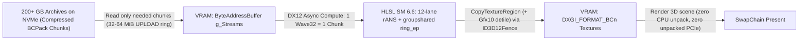

# bcpack-gpu-hlsl — Clean-Room Xbox Series BCPack (MDU rANS) Decoder in DirectX 12 HLSL SM 6.6

[](shaders/bcpack_decode.hlsl)
[](Cargo.toml)
[](LICENSE-MIT)
[](#verified-bit-exactness--rtx-5080-benchmarks)

**GPU-accelerated, bit-exact Xbox Series X|S BCPack (BC1) decompressor written in HLSL Shader Model 6.6 Compute Shaders + DirectX 12 (Rust), achieving 3,383.6 MB/s (77.3× faster than 1-core CPU, 11.8× faster than multi-core CPU) on an NVIDIA RTX 5080 — with zero CPU decompression and zero uncompressed-texture PCIe copies.**

> Clean-room implementation using **100% open synthetic and procedurally generated `.bcpack` assets** — zero copyrighted or proprietary game data. Built on the exact format specification and CPU oracle from [`Ahmet-Dedeler/bcpack-rs`](https://github.com/Ahmet-Dedeler/bcpack-rs) and Microsoft's MIT-licensed [`microsoft/silicon-rans`](https://github.com/microsoft/silicon-rans).

---

## Side-by-Side Live Comparison: NEW GPU (45 FPS) vs OLD CPU (5 FPS)

Left window: **NEW GPU Compute (`bcpack-demo-gpu.exe`)** decoding 64 compressed `.bcpack` chunks (**8 MiB BC1 every frame**) directly in VRAM on RTX 5080 (`~45.4 FPS`, `17.56 ms`).
Right window: **OLD CPU (`bcpack-demo-cpu.exe`)** decoding the exact same 64 chunks on 1 CPU core (`~5.0 FPS`, `192.65 ms`) and uploading unpacked BC1 over PCIe.


- **Full 30s HD comparison video (cropped, no audio):** [`media/demo_comparison.mp4`](media/demo_comparison.mp4) (also attached to [Release `v0.1.0`](https://github.com/POMXARK/bcpack-gpu-hlsl/releases/tag/v0.1.0))
- **High-res single-frame capture (1280×720):** [`media/demo_frame.png`](media/demo_frame.png)
- **Русская техническая документация и обзор исследований:** [`DOCS_RU.md`](DOCS_RU.md)

---

## The Problem: Why Xbox Series Compatibility Layers Bottleneck at 0.3–5 FPS

Compatibility layers and static translators running Xbox Series X|S builds on Windows PC (such as **XCL**, **AnyXboxX**, and **VIctory**) hit severe open-world frame-rate collapses (`0.3–5 FPS`) when streaming dense world textures:

1. **No BCPack hardware block on PC GPUs:** Xbox Series X|S contains a dedicated silicon **Media Decompression Unit (MDU)** that unpacks rANS-compressed `BC1–BC7` texture streams directly in memory. PC GPUs support **DirectStorage + GDeflate / Zstd**, not Microsoft's proprietary BCPack bitstream.
2. **CPU decompression chokes at ~43 MB/s per core:** Existing open-source BCPack decoders (`bcpack-rs`, `rage-texture`, `bcpack-decoder`) run on the CPU. Decoding gigabytes of streaming textures on CPU saturates cores and stalls the render thread.
3. **PCIe bandwidth wasted on unpacked textures:** Decompressing on CPU forces the translator to upload larger unpacked `BCn` blocks across PCIe every frame instead of transferring smaller compressed `.bcpack` chunks.
4. **Offline re-encoding 200+ GB archives is painful:** Recompressing entire 200+ GB game packages from BCPack to GDeflate/raw BC7 requires huge extra disk space and long preprocessing. On-the-fly GPU compute decompression solves this **without touching files on disk**.

---

## Key Solutions & Engineering Findings

This repository solves BC1 BCPack decompression directly inside a DX12 HLSL SM 6.6 compute shader ([`shaders/bcpack_decode.hlsl`](shaders/bcpack_decode.hlsl)):

### 1. `1 Wave32 Warp = 1 BCPack Chunk` (`[WaveSize(32)] [numthreads(32, 1, 1)]`)
Inside a single BCPack BC1 chunk, 12 rANS lanes share one interleaved byte stream with a clocked feeder (`MDU_RANS_FEED_WINDOW = 8` bytes/clock) and lockstep symbol emission. Trying to split one chunk across independent threads fails due to cross-lane stream dependencies, **but**:
- Mapping lanes `0..11` to threads `0..11` of a **single Wave32 warp** reproduces the Xbox MDU hardware clock-for-clock with zero inter-threadgroup synchronization.
- Open-world streaming dispatches **dozens or hundreds of independent chunks** at once (`Dispatch(num_chunks, 1, 1)`), saturating RTX 5080's 84 SMs. Because chunk latency (~17.5 ms for 16,384 blocks) is overlapped across SMs, scaling from **64 chunks (8 MiB)** to **512 chunks (64 MiB)** only increases GPU kernel time from **17.55 ms to 18.92 ms**!

### 2. Branch-Free 8-Byte/Clock Feeder + DXC `-O3` Wave Intrinsics Pitfall Solved
In `Phase 0`, multiple lanes request bytes concurrently (`want_byte`), up to 8 bytes per cycle (`rank < 8`) in lane order `0..11`.
- **Pitfall discovered on DXC 1.8 (`-T cs_6_6 -O3`) / NVIDIA driver 621.24:** Using `WavePrefixCountBits(want_byte)` followed by `WaveActiveCountBits(valid)` inside the clocked loop caused a miscompilation/reordering under `-O3` (`stream_pos` stalled early while `-Od` passed bit-exact).
- **Fix:** Replaced both intrinsics with two explicit `WaveActiveBallot` votes + `countbits`:
  ```hlsl
  uint want_mask = WaveActiveBallot(want_byte).x;
  uint rank = countbits(want_mask & ((1u << lane) - 1u));
  bool in_window = want_byte && (rank < 8u);
  uint byte_idx = stream_pos + rank;
  bool valid = in_window && (byte_idx < desc.stream_len);
  if (in_window && !valid) exhausted = true;
  uint valid_mask = WaveActiveBallot(valid).x;
  stream_pos += countbits(valid_mask);
  ```
  This compiles cleanly under `-O3`, executes in fewer wave instructions (single `VOTE.ANY` + `POPC` per ballot on NVIDIA), and passes 100% bit-exact verification.
- **Uniform control flow rule:** Threads `12..31` never early-return before the decode loop so all 32 lanes participate uniformly in `WaveActiveBallot`, `WaveActiveAnyTrue`, `WaveActiveAllTrue`, `WaveActiveSum`, and `WaveReadLaneAt`.

### 3. Zero Intermediate Symbol Buffer & Unified `groupshared ring_ep[256]`
- When all active lanes hold a symbol in lockstep, lane `0` pulls all 11 active lane symbols directly from registers via `WaveReadLaneAt(slot_sym, k)` — **zero global memory writes/reads for intermediate symbols**.
- A 1 KB `groupshared uint ring_ep[256]` array is pre-filled from the 256-slot preset endpoint window (`g_Window`) at group start. Because back-reference distance `d` is in `0..255`, `(block_idx - d) & 255` reads the exact preset slot when `d > block_idx` (before `ring_ep` wraps past 256) and the recent decoded endpoint when `d <= block_idx` — **one unified branch-free lookup**.

### 4. On-the-Fly Streaming Architecture for 200+ GB Games (No Disk Re-Encoding)



In a compatibility layer (`XCL` / `AnyXboxX`), hooking `IDStorageQueueX` to enqueue compressed chunks into a DX12 **Async Compute Queue** (`D3D12_COMMAND_LIST_TYPE_COMPUTE`) running this shader (+ a lightweight Gfx10 detile pass for retail tiled textures) keeps decompression entirely on the GPU without modifying 200+ GB of game archives.

---

## Verified Bit-Exactness & RTX 5080 Benchmarks

Tested on **NVIDIA GeForce RTX 5080 (Driver 621.24)**, Windows 10/11 SDK `10.0.26100.0` (`DXC 1.8`):

### Bit-Exact Verification (`bcpack-gpu-demo --verify`)
- `bcpack-rs` upstream unit + roundtrip suite (`cargo test --release`): **PASS** (3 unit + 10 roundtrip + 1 doctest).
- Synthetic streams (5 chunks, 21,824 blocks — testing alphabet narrowing `z`, 2/3-byte headers, all 16 models `q=0..15`, preset window pre-start refs): **PASS (`0` byte mismatches)**.
- All 8 procedural 512×512 `.bcpack` textures (1.00 MiB BC1 total): **PASS (`0` byte mismatches)**.

### Throughput Benchmark (`bcpack-gpu-demo --bench`, 1 chunk = 16,384 BC1 blocks = 128 KiB)

| Batch Size | Output BC1 | CPU 1-Core (`bcpack-rs`) | CPU Multi-Core (Rayon) | RTX 5080 GPU Kernel | Speedup vs 1T / MT | GPU Kernel + PCIe Upload |
|---:|---:|---:|---:|---:|---:|---:|
| 64 chunks | 8.0 MiB | 188.03 ms (`42.5 MB/s`) | 30.77 ms (`260.0 MB/s`) | **17.550 ms** (`455.8 MB/s`) | **10.7× / 1.8×** | 18.69 ms (`428.1 MB/s`) |
| 256 chunks | 32.0 MiB | 735.02 ms (`43.5 MB/s`) | 118.21 ms (`270.7 MB/s`) | **17.780 ms** (`1799.8 MB/s`) | **41.3× / 6.6×** | 19.02 ms (`1682.3 MB/s`) |
| 512 chunks | 64.0 MiB | 1462.41 ms (`43.8 MB/s`) | 222.55 ms (`287.6 MB/s`) | **18.915 ms** (`3383.6 MB/s`) | **77.3× / 11.8×** | 19.97 ms (`3204.3 MB/s`) |

### Live 1280×720 3D Streaming Scene FPS (Decompressing All Chunks On-the-Fly Every Frame)

| Executable / Mode | Streamed / Frame | Measured Live FPS | Decompression / Frame |
|---|---:|---:|---:|
| `bcpack-demo-cpu.exe` (OLD: CPU 1-Core) | 64 chunks (8.0 MiB) | **5.32 FPS** | 186.55 ms |
| `bcpack-demo-cpu.exe --mt` (OLD: CPU Multi-Core) | 64 chunks (8.0 MiB) | **29.87 FPS** | 31.68 ms |
| `bcpack-demo-gpu.exe` (NEW: GPU RTX 5080 HLSL) | 64 chunks (8.0 MiB) | **45.81 FPS** | 17.44 ms |
| `bcpack-demo-gpu.exe --chunks 256` (NEW: GPU 4× Load) | 256 chunks (32.0 MiB) | **44.36 FPS** | 17.53 ms |

---

## Quick Start (Windows, DirectX 12 + Shader Model 6.6 GPU)

Pre-compiled `.dxil` shaders are included in `shaders/` so you only need **Rust (MSVC toolchain)** to build and run:

```bat
git clone https://github.com/POMXARK/bcpack-gpu-hlsl.git
cd bcpack-gpu-hlsl

REM Build release binaries (bcpack-gpu-demo, bcpack-demo-cpu, bcpack-demo-gpu)
cargo build --release

REM 1. Run bit-exact CPU vs GPU verification + benchmark (headless compute)
target\release\bcpack-gpu-demo.exe --verify --bench

REM 2. Run OLD CPU approach (1-core by default, press [M] for multi-core)
target\release\bcpack-demo-cpu.exe

REM 3. Run NEW GPU HLSL SM 6.6 approach (64 chunks/frame, press [UP/DOWN] up to 256 chunks = 32 MiB/frame)
target\release\bcpack-demo-gpu.exe

REM 4. Run unified live toggle demo ([SPACE] switches GPU <-> CPU on the fly)
target\release\bcpack-gpu-demo.exe --demo
```

To recompile the HLSL shaders yourself (requires Windows 10/11 SDK `dxc.exe`):
```bat
shaders\compile_shaders.bat
```

### Controls Inside the 3D Window
- **`UP` / `DOWN`** — Adjust streamed BC1 chunks per frame (`8, 16, 32, 64, 128, 256` chunks = `1..32 MiB/frame`)
- **`M`** — In CPU mode, toggle `1-Core` ↔ `Multi-Core (Rayon)`
- **`SPACE`** — In unified `bcpack-gpu-demo --demo`, toggle `GPU HLSL SM 6.6` ↔ `CPU bcpack-rs`
- **`ESC`** — Exit

---

## Roadmap & Related Research
- **Next steps:** Port **BC7 (16-lane rANS)** once block semantics are finalized upstream, add **Gfx10 tile-to-linear detile** compute pass for retail `.ttpf` pools, and run decompression on a DX12 **Async Compute Queue** (`IDStorageQueueX` hook target for XCL / AnyXboxX).
- **Related open-source BCPack projects (all CPU as of Nov 2026):**
  - [`Ahmet-Dedeler/bcpack-rs`](https://github.com/Ahmet-Dedeler/bcpack-rs) — clean-room BCPack spec, CPU BC1 decoder, synthetic encoder
  - [`ifBars/rage-texture`](https://github.com/ifBars/rage-texture) — CPU `RDS5`/`TTPF` extractor (`BC1/3/4/5/6H/7`)
  - [`Tim0219800/bcpack-decoder`](https://github.com/Tim0219800/bcpack-decoder) — clean-room CPU BC1 decoder
  - [`xcl-dev/xcl`](https://github.com/xcl-dev/xcl) — Xbox Series → Windows compatibility layer (RDNA2→DXIL, UMA, D3D12)
- **GPU entropy decoding literature & libraries:**
  - Microsoft [`silicon-rans`](https://github.com/microsoft/silicon-rans) (`mdu_minirans.v`, patent US11234023B2) & DirectStorage (GDeflate / Zstd compute shaders)
  - NVIDIA `nvCOMP` + GPUDirect Storage
  - Weißenberger & Schmidt — *Massively Parallel ANS Decoding on GPUs* (ICPP, [`weissenberger/multians`](https://github.com/weissenberger/multians))
  - *Recoil: Parallel rANS Decoding with Decoder-Adaptive Scalability* ([arXiv:2306.12141](https://arxiv.org/abs/2306.12141))
  - Meta [`facebookresearch/dietgpu`](https://github.com/facebookresearch/dietgpu) & Fabian Giesen [`rygorous/ryg_rans`](https://github.com/rygorous/ryg_rans)

## License & Attribution
Licensed under `MIT OR Apache-2.0`. See [`LICENSE-MIT`](LICENSE-MIT), [`LICENSE-APACHE`](LICENSE-APACHE), and [`THIRD_PARTY_NOTICES.md`](THIRD_PARTY_NOTICES.md).
Contains no copyrighted or proprietary game assets; all 8 test textures are procedurally generated at runtime into `./assets/`.
